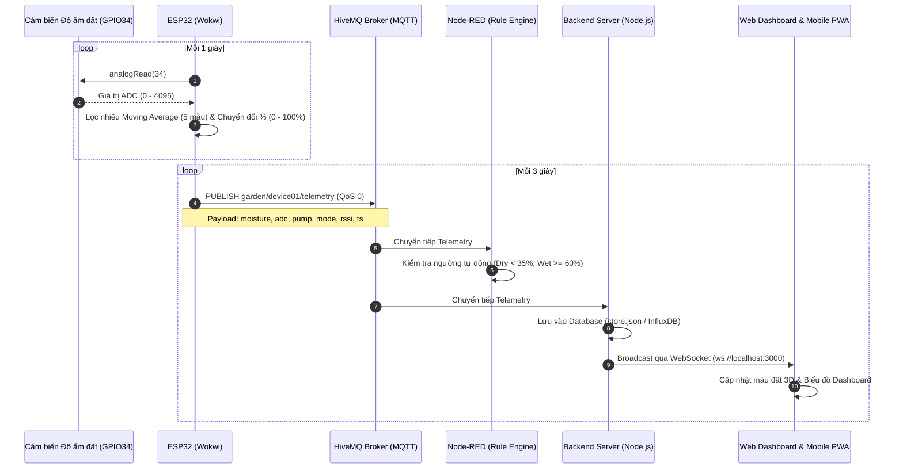
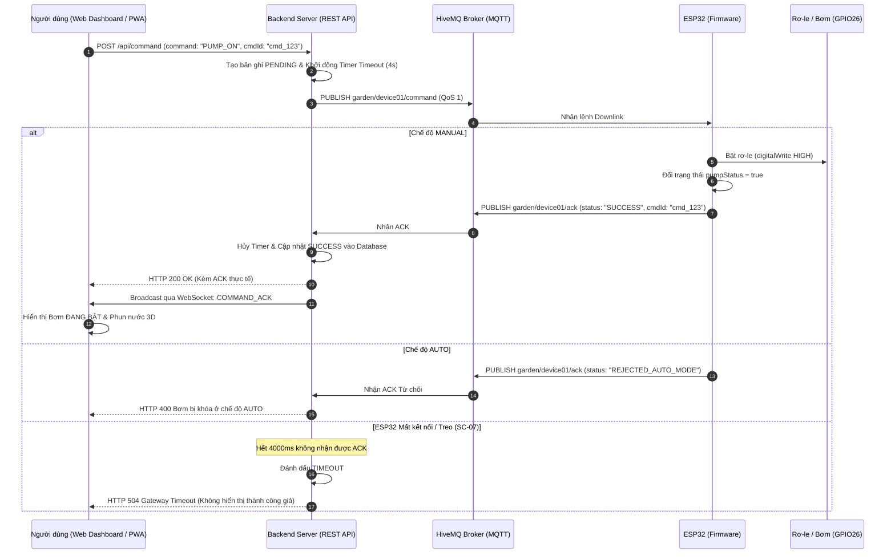

# LUỒNG DỮ LIỆU ĐO ĐỘ ẨM ĐẤT VÀ ĐIỀU KHIỂN TƯỚI N03 (DATA FLOW)

## 1. TỔNG QUAN PHẠM VI DỮ LIỆU
Hệ thống tập trung 100% vào bài toán:
- **Đo lường độ ẩm đất** từ cảm biến analog qua ESP32 ADC.
- **Phân loại 3 trạng thái đất**:
  - Dưới 35%: Đất khô
  - Từ 35% đến dưới 60%: Đất trung bình
  - Từ 60% trở lên: Đất đủ ẩm
- **Điều khiển tưới cây tự động và thủ công** qua Relay rơ-le và máy bơm.
- **Phản hồi xác nhận lệnh (ACK)** và phát hiện thiết bị mất kết nối (LWT).

---

## 2. LUỒNG DỮ LIỆU UPLINK (TỪ CẢM BIẾN LÊN GIÁM SÁT)

---

## 3. LUỒNG DỮ LIỆU DOWNLINK (ĐIỀU KHIỂN MÁY BƠM VÀ XÁC NHẬN ACK)

