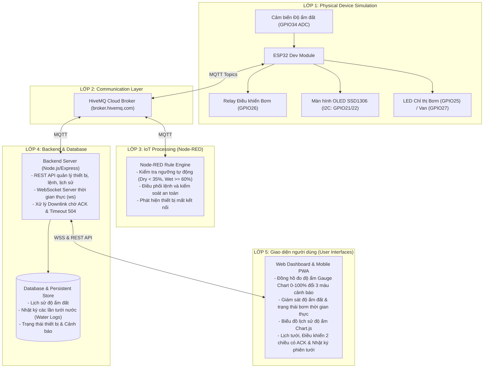

# SYSTEM ARCHITECTURE – N03 SMART GARDEN DIGITAL TWIN (PHẠM VI ĐỘ ẨM ĐẤT)

## 1. TỔNG QUAN KIẾN TRÚC HỆ THỐNG
Hệ thống N03 Smart Garden Digital Twin tập trung chuyên biệt vào bài toán: **Đo lường độ ẩm đất, giám sát trạng thái đất và điều khiển tự động hóa hệ thống tưới cây**.

---

## 2. MA TRẬN TOPIC VÀ DỮ LIỆU ĐỘ ẨM ĐẤT

| Topic | Hướng | QoS | Payload | Chức năng |
|---|---|---|---|---|
| `garden/device01/telemetry` | ESP32 $\to$ Broker | 0 | JSON (`moisture`, `adc`, `pump`, `valve`, `mode`, `rssi`, `ts`) | Truyền dữ liệu độ ẩm đất và trạng thái bơm định kỳ 3s |
| `garden/device01/status` | ESP32 $\to$ Broker | 1 (Retain) | `ONLINE` / `OFFLINE` (LWT) | Trạng thái kết nối phần cứng |
| `garden/device01/command` | Backend $\to$ ESP32 | 1 | JSON (`cmdId`, `command`, `mode`, `ts`) | Lệnh Bật/Tắt bơm, đổi chế độ, dừng khẩn cấp |
| `garden/device01/ack` | ESP32 $\to$ Backend | 1 | JSON (`cmdId`, `status`, `pump`, `mode`, `moisture`, `ts`) | Xác nhận phản hồi sau khi rơ-le đã thực thi lệnh |
| `garden/device01/alert` | ESP32 $\to$ System | 1 | JSON (`code`, `message`, `ts`) | Cảnh báo: `SENSOR_FAULT`, `PUMP_TIMEOUT`, `EMERGENCY_STOP` |

---

## 3. BA TRẠNG THÁI ĐỘ ẨM ĐẤT
1. **Đất khô (Dưới 35%)**:
   - Màn hình OLED hiển thị: `DAT KHO!`.
   - Chế độ AUTO: Kích hoạt rơ-le bật máy bơm nước.
   - Đồng hồ đo độ ẩm (Gauge Chart): Kim xoay về vùng Đỏ ($<35\%$), nhãn cảnh báo `"Đất khô - Cần tưới"`.
2. **Đất trung bình (Từ 35% đến dưới 60%)**:
   - Màn hình OLED hiển thị: `DAT TRUNG BINH`.
   - Giữ nguyên trạng thái bơm hiện tại (tránh đóng/ngắt liên tục).
   - Đồng hồ đo độ ẩm (Gauge Chart): Kim xoay về vùng Vàng ($35\% - 60\%$), nhãn `"Độ ẩm vừa phải"`.
3. **Đất đủ ẩm (Từ 60% trở lên)**:
   - Màn hình OLED hiển thị: `DAT DU AM`.
   - Chế độ AUTO: Tự động ngắt máy bơm.
   - Đồng hồ đo độ ẩm (Gauge Chart): Kim xoay về vùng Xanh lá ($\ge 60\%$), nhãn `"Đất đủ ẩm - Tối ưu"`.
